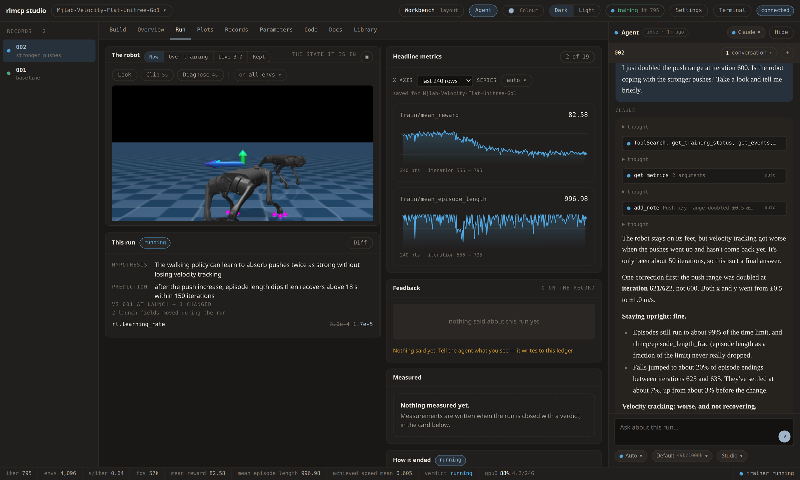
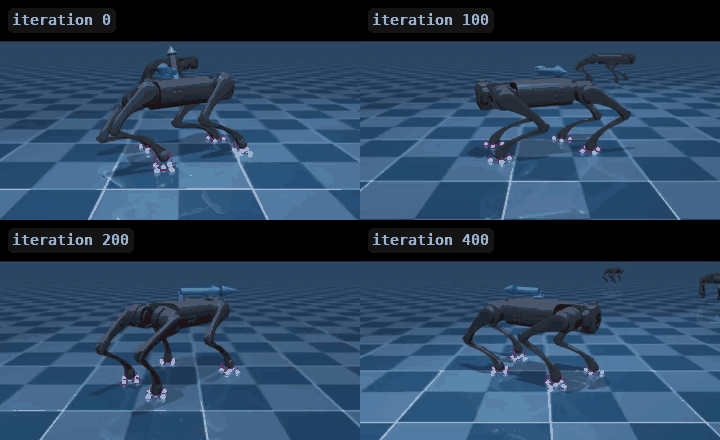
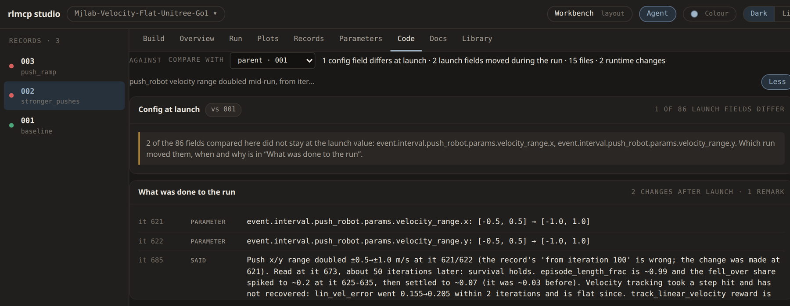
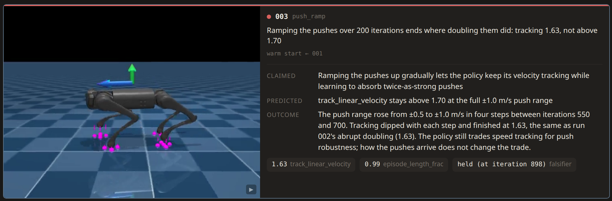
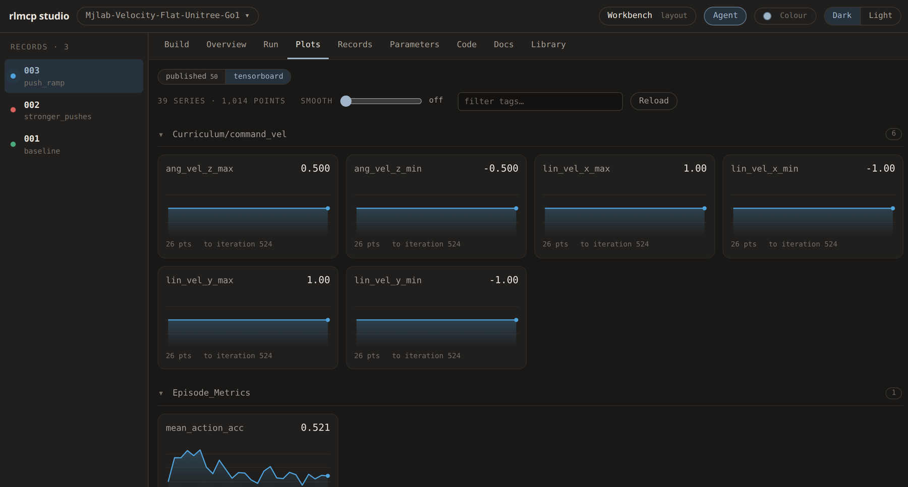

<h1 align="center">rl-mcp-studio</h1>

<p align="center">
  <b>Watch, steer and record RL training runs from a browser,<br>with an AI agent beside the run.</b>
</p>

<p align="center">
  <a href="https://github.com/mktk1117/rl-mcp-studio/actions/workflows/ci.yml"></a>
  <a href="LICENSE"></a>
  
  <a href="https://github.com/mktk1117/rl-mcp"></a>
</p>

<picture>
  <source media="(prefers-color-scheme: light)" srcset="docs/media/studio-light.png">
  
</picture>

rl-mcp-studio is a local web app over [rl-mcp](https://github.com/mktk1117/rl-mcp).
It reads your run records and the session directories of live training runs,
shows them as plots, frames, clips and a record graph, and lets you steer a
running trainer (change a parameter, take a frame, record a clip) without a
terminal. A coding agent (Claude, Codex or Antigravity) sits in a panel beside
the run with rl-mcp's tools attached, and every conversation is kept with the
run it was about. The backend imports `rlmcp` but never torch or a simulator,
so starting or stopping the studio cannot disturb training.

> **Experimental.** The studio works, but its interfaces are still changing
> and it has not been released yet. If something breaks, please
> [open an issue](https://github.com/mktk1117/rl-mcp-studio/issues).

## A tour

Every picture here comes from three short runs of mjlab's built-in
`Mjlab-Velocity-Flat-Unitree-Go1` task: a baseline, then two attempts at
making the walking policy cope with stronger pushes.

### Watch it learn

The trainer records a short clip on a schedule while it trains, so a run is
a sequence of clips you can step through, not a number you wait on. Press **Look** for
a frame now, or **Clip** for a few seconds of the current policy; the trainer
renders it between rollout batches and never pauses to do it.

<p align="center">
  
</p>

### Ask the agent beside the run

The agent panel opens a conversation pinned to the run you are looking at,
with rl-mcp's tools attached: it reads the metrics, takes frames, compares
runs and writes notes to the run's log. In the screenshot above it was asked
whether the robot copes with pushes doubled mid-run, read the metrics, and
answered: still upright, but trading speed tracking for it. Conversations are
kept with the run and survive a restart.

### Steer a run while it trains

Change any parameter the run reports (a reward weight, a push range, the
learning rate) without stopping the trainer. Every change is stamped with the
iteration it landed on, so the diff against the parent run shows what was
different at launch *and* what was done to the run afterwards, beside what
the agent said about it.

<p align="center">
  
</p>

### Every run is a record

A run starts with a hypothesis, a prediction and a falsifier, and ends with a
verdict, an outcome and the measurements that settle it. The records view
lays a task's runs out as cards, as a graph of parents and warm starts, or as
the recipe its ancestry folds into.

<p align="center">
  
</p>

### Plots, without TensorBoard open

The run's published metrics and every TensorBoard scalar, grouped, with
smoothing, a filter and a large view for any chart.

<p align="center">
  
</p>

## Features

- **Live runs** — status, metrics and artifacts read through `rlmcp.session`,
  pushed to the browser over one WebSocket; a dropped connection replays what
  it missed.
- **Steering** — look, record a clip, diagnose and change parameters on a
  running trainer through rl-mcp's command channel, between rollout batches.
  Parameter panels are built from what the run reports, never from a list in
  the studio.
- **Records** — every run of a task as cards, as a graph, or as the recipe
  its ancestry folds into; close a run with a verdict; annotate a frame and
  file the remark in the run's feedback ledger.
- **Plots** — the run's published metrics and every TensorBoard scalar, with
  smoothing and a large view for any chart.
- **Code** — a Monaco editor over the task package, a diff between any two
  runs (code, config and interventions kept apart), and a clear note when an
  edit only applies to the next run.
- **Build** — list tasks that have never trained, run rl-mcp's gates on one,
  hold a live preview, and launch its first run. `+ New task` starts a task
  from nothing with the agent.
- **Launching** — every run starts from a stamped copy of the task's code,
  on the studio's machine or on a remote machine running `rlmcp hostd`.
- **Agent panel** — Claude, Codex or Antigravity, several conversations per
  run, Manual / Auto / Plan permission modes, approval cards, interrupt by
  typing, conversations that survive a restart, and fleet tools that let the
  agent launch and compare runs.
- **Three layouts** — Console (one column), Focus (one subject large) and
  Workbench (three columns), over the same state, in light or dark.
- **Terminal drawer** and a one-file HTML **report** of a task's history.

## Install

The studio is not on PyPI yet; a `uv tool install rl-mcp-studio` will work
once the first release is published. Until then, build the wheel from a
checkout and install that:

```bash
git clone https://github.com/mktk1117/rl-mcp-studio
cd rl-mcp-studio
uv build --wheel                       # fetches the editor/terminal libraries into the wheel
uv tool install --with "rl-mcp[server]" dist/rl_mcp_studio-*.whl
```

rl-mcp itself comes from PyPI as a dependency; `--with "rl-mcp[server]"`
adds its MCP server. rl-mcp's own commands (`rlmcp`, `rlmcp-train`) are
installed into the tool's environment but not onto your `PATH`; if you want
them in a shell too, also run `uv tool install "rl-mcp[server]"`.

To train mjlab tasks from the studio's own environment, add rl-mcp's `mjlab`
extra (this pulls in torch and MuJoCo Warp, several GB):

```bash
uv tool install --with "rl-mcp[server,mjlab]" dist/rl_mcp_studio-*.whl
```

For the Antigravity agent, add the SDK the `antigravity` extra provides:
`--with google-antigravity` on the same install line.

Then ask the install what it can do:

```bash
rlmcp-studio --check
```

It lists what it found — its own files, rl-mcp, the `rlmcp` command, the
editor libraries, a records root, the tasks your environment registers, the
renderer, a GPU, an agent credential, the MuJoCo Menagerie — with a fix for
anything missing. It exits non-zero only when the studio could not start at
all; a machine without a GPU still passes, with a warning.

## Quick start

With the `mjlab` extra installed as above:

```bash
mkdir -p ~/rl-runs && cd ~/rl-runs
rlmcp-studio --records ~/rl-runs/records --open
```

Open <http://127.0.0.1:8730> (`--open` does it for you). The task switcher
lists mjlab's built-in tasks. Pick `Mjlab-Velocity-Flat-Unitree-Go1` (or
`Mjlab-Cartpole-Balance` for something small), open the **Build** view, run
the checks, and launch a run with a hypothesis. The record opens, the run
appears in the rail, and the **Run** and **Plots** views follow it live.

A run started from a terminal with rl-mcp shows up too; if it has no record
yet, the studio offers to write one.

## Configuration

Every option resolves in the same order: **command-line flag, then
environment variable, then settings file, then default.**

| option | flag | environment | settings key | default |
| --- | --- | --- | --- | --- |
| records roots | `--records` (repeatable) | `RLMCP_RECORDS` (`:`-separated) | `records` | `./records` |
| task-card roots | `--library` (repeatable) | `RLMCP_LIBRARY` | `library` | none |
| task packages | `--task-package MODULE` (repeatable) | `RLMCP_TASK_PACKAGES` | `taskPackages` | none |
| bind address | `--host` | `RLMCP_STUDIO_HOST` | `host` | `127.0.0.1` |
| port | `--port` | `PORT` | `port` | `8730` |
| settings file | `--settings PATH` | `RLMCP_STUDIO_SETTINGS` | — | `$XDG_CONFIG_HOME/rlmcp-studio/settings.json` |
| access token | `--token` | `RLMCP_STUDIO_TOKEN` | — | reused or minted, see [security](docs/security.md) |
| remote hosts | — | `RLMCP_STUDIO_HOSTS` (JSON list) | `hosts` | none |

**The settings file** is JSON. The GUI writes it when you change a root or a
preference, and it is safe to edit by hand; unknown keys are kept, and a file
that does not parse is reported and ignored. Because a flag *overrides*
rather than extends the file, once the GUI has saved your records roots, start
the studio without `--records`.

**Records roots** are directories of rl-mcp run records. Several may be
configured; every task found in any of them appears in the task switcher.

**The task repository.** The studio treats the directory that contains a
records root as the task repository: the Code view shows it, launches stamp
its code, and tasks are built with its interpreter when it has a `.venv`
(otherwise with the studio's own). The usual layout is therefore a `records/`
directory inside your task repository.

**Task packages** are Python modules whose import registers tasks, the same
`--task-package` rl-mcp takes, so tasks from your own repository are listed
before they have ever run.

**Other useful variables:** `MUJOCO_MENAGERIE` (the robot models many tasks
load), `RLMCP_STUDIO_CODEX` (which `codex` binary to run), and the agent
credentials in [docs/providers.md](docs/providers.md). The studio keeps its
own state (agent transcripts, the token) under
`$XDG_STATE_HOME/rlmcp-studio/`.

### Training on another machine

On the GPU machine, with rl-mcp and your tasks installed, run rl-mcp's host
daemon (a token is required to listen beyond localhost):

```bash
rlmcp hostd --root /path/to/logs --bind 0.0.0.0 --port 8740 --token "$RLMCP_HOST_TOKEN"
```

Then describe the host in the studio's settings file:

```json
{
  "hosts": [
    {"name": "gpu-box", "url": "http://gpu-box:8740", "token": "<the host token>",
     "python": "/path/to/tasks/.venv/bin/python",
     "cwd": "/path/to/tasks", "log_root": "/path/to/logs"}
  ]
}
```

`python`, `cwd` and `log_root` are paths on the host. A launch on that host
opens its record here, pushes the stamped code tree to the host, and trains
from that copy; the run appears in the same panels as a local one. Prefer a
VPN or SSH tunnel between the machines, and keep the settings file private:
it holds the host's token.

## Agents

| provider | sign-in | notes |
| --- | --- | --- |
| Claude | *Sign in* in the panel (`claude auth login`), or `ANTHROPIC_API_KEY` | needs the `claude` CLI on `PATH` |
| Codex | `codex login`, or `OPENAI_API_KEY` | needs the `codex` CLI |
| Antigravity | `GEMINI_API_KEY` or Vertex AI credentials | needs the `antigravity` extra |

The studio never stores a credential; each vendor's own CLI or SDK handles
sign-in. Use each provider in line with its terms of service. Details:
[docs/providers.md](docs/providers.md).

## Security

The studio can edit code, launch training and open a shell on its machine.
It binds `127.0.0.1` by default and requires a per-studio token on every API
route; do not expose it to a network you do not trust. See
[docs/security.md](docs/security.md).

## Documentation

- [docs/architecture.md](docs/architecture.md) — how the studio is built
- [docs/providers.md](docs/providers.md) — agent providers and sign-in
- [docs/security.md](docs/security.md) — the access model
- [AGENTS.md](AGENTS.md) — rules and layout for changing the code
- [CONTRIBUTING.md](CONTRIBUTING.md) — development setup, tests, pull requests

## Development

```bash
git clone https://github.com/mktk1117/rl-mcp
git clone https://github.com/mktk1117/rl-mcp-studio
cd rl-mcp-studio
uv sync --all-extras
uv run rlmcp-studio
uv run pytest
```

A checkout resolves rl-mcp from the sibling `../rl-mcp` checkout, so you can
develop against unreleased rl-mcp changes; a built wheel depends on rl-mcp
from PyPI. A checkout fetches the editor and terminal libraries into the user
cache on first start. `scripts/fresh-install.sh` builds the wheel into a
clean container and checks it the way a new user would. See
[CONTRIBUTING.md](CONTRIBUTING.md) and [AGENTS.md](AGENTS.md).

## Third-party components

The client uses [Monaco Editor](https://github.com/microsoft/monaco-editor)
(MIT) and [xterm.js](https://github.com/xtermjs/xterm.js) (MIT). They are
not kept in this repository: `rlmcp_studio/vendor.py` pins exact versions and
integrity hashes, and they are downloaded from the npm registry when the
wheel is built (or, for a source checkout, on first start). Their license
files and third-party notices ship alongside them in
`rlmcp_studio/web/vendor/`.

## License

Apache License 2.0. See [LICENSE](LICENSE).
